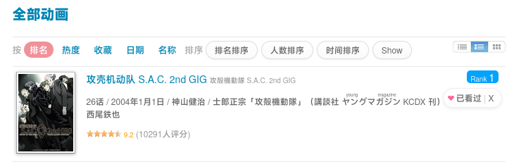

# "赛博朋克"的未来

人工智能是人类自可以自主创造工具以促进生产活动以来最伟大的发明, 前提是这一成果是可以被全人类所可及的, 而不是成为极少数垄断寡头奴役绝大多数人类的工具.

但是, 黄仁勋被迫辞职, Anthropic/OpenAI 上市, Hermes 为中国开源大模型"西方化", 民主党的上台, Anthropic 全面封禁"敌对国家", 山姆奥特曼认为闲置算力应该被集中...... 事情似乎在朝着最坏的结局前进.

## 人工智能泡沫与政治

事实上, 我不认为黄仁勋就是完美的. 人工智能是一种上限极高的技术, 但黄以及和他关联的硅谷和芯片厂商们实实在在的创造了一个巨大的金融泡沫, 他们在赌的是 AGI 能够在几年内实现, 但我们没法预测未来, 如果在这一轮周期内真正的提升人类的生产力, 那么人类可能会引来史上最严重的一次金融危机. 所以, 我并不认为提前阻止这一疯狂的投机行为本身有什么错.

黄仁勋背叛自己的家庭, 他值得被自己的家人审判, 甚至他的妻子就算离婚, 分走他一半的资产我也觉得是他活该.

但问题在于政治, 美国民主党和共和党他们的斗争的原因并不是所谓的泡沫, 而是纯粹的党争. 熟读历史的中国人应该都知道历来党争发展到极点后会发生什么.

现实没有人真的在意黄仁勋到底有没有出轨, 到底玩弄了多少女性, 到底有多少人为了利益向其出卖了自身的价值, 有些人只是想让他死. 大家都在假模假样的为他的妻子和孩子感到悲哀, 虽然他的妻子和孩子对这事是心知肚明的, 哪怕硅谷的巨头们都有过出轨的经历, 甚至有去爱泼斯坦岛的经历.

历史是螺旋式上升的, 科学家负责上升, 政治家负责螺旋.

## 赛博朋克的世界就在眼前

> 未来, 企业网络可以覆盖全球. 环绕着的电子与光随处可见, 尽管信息化高度发展, 仍不足以让一个国家或民族消失.

数年前我曾看过一部非常经典的动画: 攻壳机动队. 这是一部以赛博朋克/人工智能为主题的动画, 长期以来是是 Bangumi 上评分最高的动画.

但在今年之前, 我一直都只是把这部动画视作一种"严肃向"动画, 我曾认为这部作品更多的还是在探讨人类的个体化, 与此同时我也并不相信其所描写的社会可能会成真.

直到今年, AI 的能力实现了巨大的爆发, 越来越多的科学谜题被解答, 越来越多的工作可以被人工智能所取代.

但与此同时, 这种技术依旧被掌握在极少数的垄断资本巨头手中, 这伙人反对开源, 反对蒸馏, 反对"异端", 中间不乏极端崇尚宗教的人.

我终于意识到, 攻壳机动队里的未来, 已经距离我们不远了. 如果 AGI 被他们实现, 那么攻壳机动队这部作品所构想的社会就会成为现实.

## 总结

我是在哗众取宠吗? 现在是, 但未来, 回旋镖打回来时大家可能会感到非常痛.

今天所有沉默甚至投降给垄断资本巨头的人终将成为新时代的奴隶.
